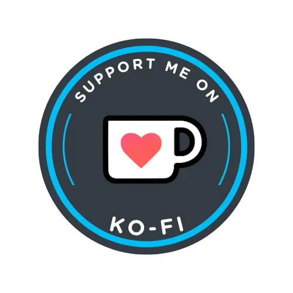

# Image to ICO Converter (PNG2ICO Web)

A static, client-side image-to-ICO converter. Drop an image, choose the icon sizes, and download a multi-size `.ico` file. Decoding, resizing, and ICO encoding run entirely in the browser: files are never uploaded.

**Live:** <https://png2ico.pulcitopi.qzz.io>
**Repository:** <https://github.com/gulp79/IMG2ICO>

## Features

- Converts **PNG, JPEG, WebP, AVIF, JPEG XL, GIF, BMP, and SVG** to ICO.
- Multi-size output: **16, 32, 48, 64, 128, 256 px**.
- Automatic size selection (all sizes up to the source resolution) or manual selection.
- SVG is rasterized directly at every icon size, so vector icons stay sharp.
- Non-square images are scaled proportionally and centered on a transparent canvas.
- 100% client-side: no backend, no uploads, no analytics, no remote assets.
- Responsive dark UI built with Tailwind CSS and shadcn/ui.

## Supported input formats

| Format | Extensions | Notes |
| --- | --- | --- |
| PNG | `.png` | Transparency preserved. |
| JPEG | `.jpg`, `.jpeg`, `.jpe`, `.jfif` | No alpha channel. |
| WebP | `.webp` | Transparency preserved; animated files use the first frame. |
| AVIF | `.avif` | Transparency preserved; animated files use the first frame. |
| JPEG XL | `.jxl` | Decoded natively by Chrome 155+, Firefox 158+, and Safari 17+. Edge and older browsers are not supported and receive a clear error. |
| GIF | `.gif` | First frame only. |
| BMP | `.bmp`, `.dib` | No alpha channel. |
| SVG | `.svg` | Rasterized per size; scripts are not executed when loaded as an image. |

TIFF, HEIC/HEIF, and camera RAW formats are **not** supported because browsers cannot decode them reliably.

## How it works

1. `src/components/FileUpload.tsx` validates the selected or dropped file against `src/utils/imageFormats.ts`.
2. `src/utils/icoConverter.ts` loads the image through an `HTMLImageElement` (SVGs are normalized first so their intrinsic size is well-defined).
3. The image is drawn into square canvases at the selected sizes, preserving the aspect ratio and centering it on transparency.
4. Each canvas is encoded as PNG and packed into a single ICO container.

The ICO layout follows the standard: a 6-byte header, one 16-byte directory entry per image, and a PNG payload per size. In directory entries, a width or height of `0` means 256 px. Entries are written largest first.

## Tech stack

- Vite 5 + React 18 + TypeScript
- Tailwind CSS 3 + shadcn/ui (Radix primitives)
- React Router
- Vitest + Testing Library (jsdom)

## Getting started

Requirements: Node.js 20+ and npm.

```sh
npm ci
npm run dev      # http://localhost:5173
```

| Script | Description |
| --- | --- |
| `npm run dev` | Start the Vite development server. |
| `npm run build` | Production build into `dist/` (Vite only, no type checking). |
| `npm run preview` | Preview the production build locally. |
| `npm run lint` | Run ESLint. |
| `npm run typecheck` | Run `tsc --noEmit` against the app config. |
| `npm test` | Run the test suite once. |
| `npm run test:watch` | Run tests in watch mode. |

If Node.js is not available on the host, build through Docker:

```sh
docker run --rm -v "$PWD":/app -w /app node:20-alpine sh -c "npm ci && npm run typecheck && npm run build"
```

## Deployment

The site is served by nginx as static files from `/usr/share/nginx/html/png2ico` for `png2ico.pulcitopi.qzz.io`. The server block uses `try_files $uri $uri/ /index.html` for SPA routing.

```sh
npm ci
npm run typecheck
npm run build

# Back up the current release, then copy the build contents.
cp -a /usr/share/nginx/html/png2ico "/usr/share/nginx/html/png2ico.backup-$(date +%Y%m%d-%H%M%S)"
install -d /usr/share/nginx/html/png2ico
cp -a dist/. /usr/share/nginx/html/png2ico/
chown -R nginx:nginx /usr/share/nginx/html/png2ico
```

`base` in `vite.config.ts` is `/` because the site is served from the root of its subdomain. Change it only if the deploy path changes.

## Project structure

```
src/
  pages/Index.tsx             # Main flow: upload -> preview -> sizes -> convert -> download
  pages/NotFound.tsx
  App.tsx                     # Router and providers
  components/
    FileUpload.tsx            # Drag & drop and file picker with format validation
    ImagePreview.tsx          # Preview with transparency checkerboard
    SizeSelector.tsx          # Auto or manual size selection (16-256)
    ConvertedIcon.tsx         # Result card and blob download
    ui/                       # shadcn/ui components
  utils/
    imageFormats.ts           # Supported formats, MIME/extension detection
    icoConverter.ts           # Image loading, canvas rendering, ICO encoding
  test/                       # Vitest setup and tests
public/                       # Static assets (robots.txt, placeholder.svg)
.github/workflows/build.yml   # Release workflow: builds and attaches the dist zip
.github/dependabot.yml        # Automated dependency updates
```

## Testing

```sh
npm test
```

jsdom does not implement the canvas 2D API, so tests cover pure logic (format detection, size selection). Testing the full encoder requires mocking `HTMLCanvasElement.getContext` and `toDataURL`, or running the suite in a real browser.

## Privacy

Conversion happens locally in the browser. No image data is sent to a server, and the app loads no third-party scripts, fonts, or trackers.

## Limitations

- Animated GIF, WebP, and AVIF inputs use the first frame; animated ICO output is not produced.
- Maximum ICO entry size is 256 px.
- Very large source images are limited only by browser memory.
- JPEG XL support depends on the browser (see the table above).

## Releasing

Publishing a GitHub release triggers `.github/workflows/build.yml`, which runs the type check, the tests, and the production build, then attaches `png2ico-web-<tag>.zip` (the contents of `dist/`) to that release. Nothing is published on regular pushes.

## Author

Created and maintained by [gulp79](https://github.com/gulp79).

> ☕ **Enjoying my work?**
>
> &nbsp; <a href="https://ko-fi.com/gulp79"></a>
